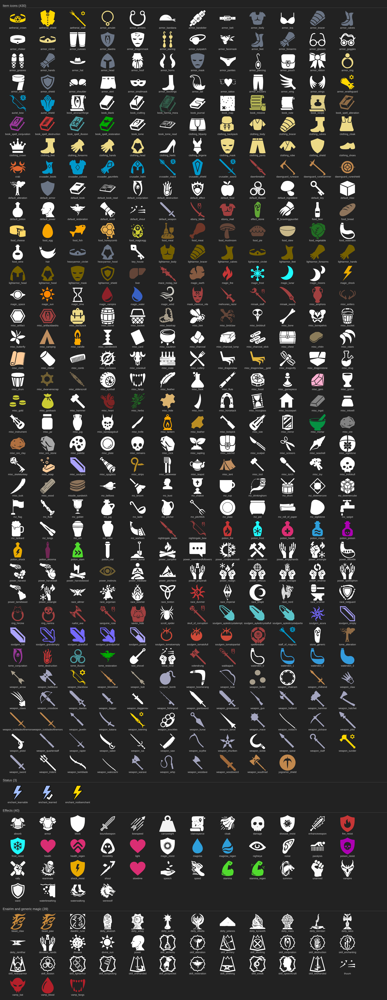

# DICK - Dark's Icon & Category Kit

One icon set everywhere for Skyrim Special Edition / Anniversary Edition: the same item, spell, status and effect icons in the inventory, QuickLoot and TrueHUD Recent Loot, plus a full, configurable sort order and extra columns for SkyUI's inventory, crafting and magic menus.

## What it does
- Icons for items, spells, powers, shouts and Active Effects rows (by effect or by what causes it), shown through SVG and PNG Icon Injector.
- An in-game menu (MCM Helper) to change the sort order of every list (presets or five custom levels, equipped items first, reverse order with the arrow down).
- Extra columns for the inventory, the crafting menus (forge, grindstone, workbench, smelter, tanning rack, enchanting table, alchemy lab, cooking pot) and the magic menu, all switchable in the menu.
- Enchantment icons on the Enchanting Table (work in progress, off by default).
- Support for Creation Club Survival Mode, Frostfall and SunHelm Survival columns.

## Requirements
SKSE64, SkyUI, MCM Helper, Inventory Interface Information Injector (I4), SVG and PNG Icon Injector, Inventory Injector, Object Categorization Framework with its KID files, and the Address Library for SKSE Plugins. Full list and details are in `README.txt` inside the download.

## Install
Download `DICK - Dark's Icon & Category Kit v0.12.0 (FOMOD).zip` from the [Releases](../../releases) page and install it with Vortex or Mod Organizer 2. The installer asks for your game version (Skyrim SE 1.5.97 or AE 1.6.x / 1.7.x) and which survival mods to show columns for. Load it after "PNG Icon Injector".

## Credits and licence
The plugin is GPL-3.0-or-later (see `LICENSE`). Icon sources and licences are listed in `OPEN_ICON_CREDITS.txt`. See `CHANGELOG.md` for the history.
